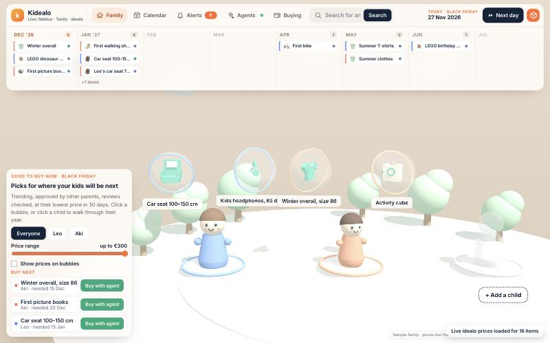
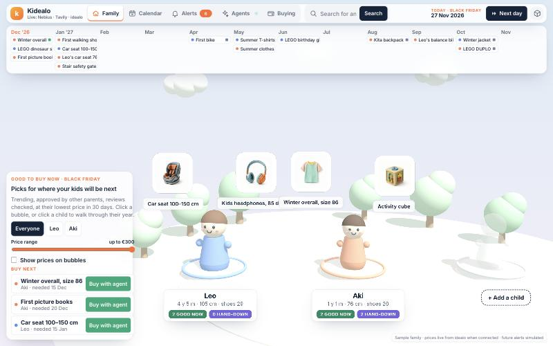
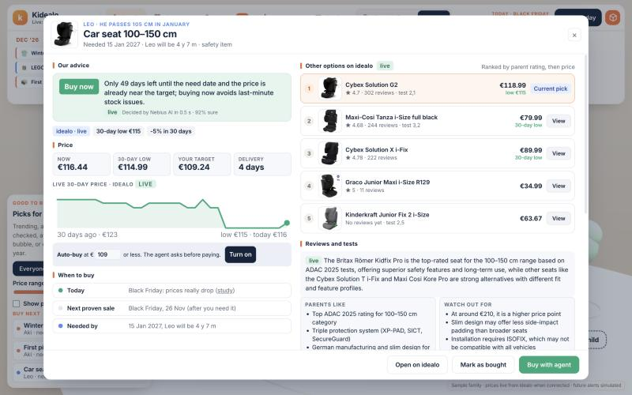
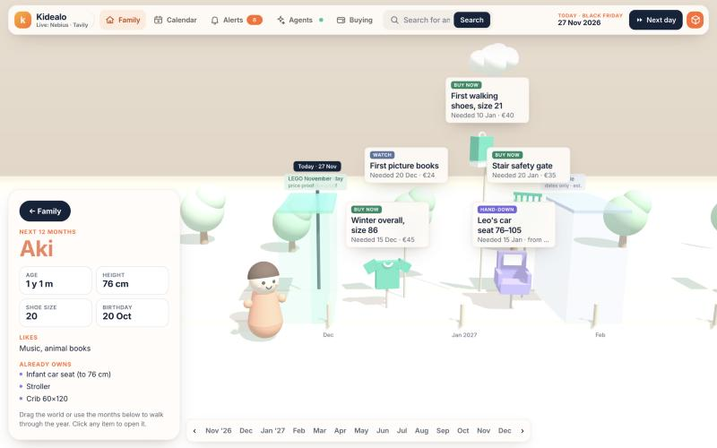

# Kidealo

**Kidealo knows what your kids will need next, and the best time to buy it.**

Built in one afternoon at the **Agentic Hackathon Berlin** on 27 Nov 2026 (Black Friday), with the **idealo MCP**, **Nebius Token Factory**, **Tavily** and **Norma**.

▶️ **Watch the demo video:** https://www.loom.com/share/bd7de46eb1d444d081bea13ee2cf57f8

🖥️ **Pitch slides:** [`docs/pitch/kidealo-pitch.html`](docs/pitch/kidealo-pitch.html). Download it and open it in any browser (← → to move, F for full screen). The demo scripts are in [`docs/DEMO.md`](docs/DEMO.md).



---

## The problem

Kids outgrow everything every few months: clothes, shoes, car seats, bikes. Parents buy in a rush, at whatever the price is that week, and forget what the older sibling already has in the cellar.

- **79%** of products were cheaper on Black Friday than in October (idealo price study, 2025). So timing matters.
- A famous sale name isn't proof of a good price, though. Kidealo only says "wait" when a past sale has *measured* price proof.
- **4,671** EU product safety alerts were issued in 2025, 16% of them for toys (EU Safety Gate report). Nobody checks recalls at the moment of buying.

## What Kidealo does

You add your children: age, height, shoe size and what they already own. Kidealo plans their **next 12 months**, for example winter boots in the next size before January, a bigger car seat when Leo passes 105 cm, a backpack before Kita starts in August. Hand-downs from an older sibling cost €0.

Then AI agents look after every item:

| Agent | What it does | Powered by |
|---|---|---|
| **Scout** | Finds the real product, compares live shop offers, pulls the 30-day price history | **idealo MCP** (`search_products`, `get_product_offers`, `get_product_price_history`, `get_product_details`) |
| **Reviewer** | Searches the web for tests, parent reviews and forum discussions, then summarises them with sources | **Tavily** + **Nebius** |
| **Guardian** | Checks the product against recent recalls | **EU Safety Gate** public API |
| **Judge** | Decides **Buy now / Wait / Watch / Ask parent**, with one clear reason and a confidence score, in about 0.5 s | **Nebius Token Factory** (`nvidia/Nemotron-3_5-Lightning`, fallback `openai/gpt-oss-120b`) |
| **Buyer** | Picks the best offer (price, shop rating, delivery, free returns), checks your budget, waits for your approval | idealo offer links |

Every call is logged live in the **Agents** tab, so you can see that it's real.

## A tour of the app

### 1. Home: your family at a glance
The 3D island shows your children. The bubbles above them are what's **good to buy now**: trending, well reviewed and at a low price. The **month strip** at the top shows what each child needs over the coming months. **Buy next** on the left lists the most urgent items, each with a *Buy with agent* button. The orange cube button at the top right switches between 3D items and illustrated pictures.



### 2. The product page: everything you need to decide
Click any item to open it. The page has five sections:

1. **Our advice:** the live Nebius verdict in one sentence, for example "Decided by Nebius AI in 0.5 s · 92% sure".
2. **Price:** the live 30-day price chart from idealo, plus **auto-buy** at your price. The agent still asks before paying.
3. **When to buy:** today's proven sale, the next proven sale, and when the child needs the item.
4. **Other options on idealo:** the top 5 real products, ranked by parent rating and number of reviews, then price. **Choose** swaps the product in place, and the decision, price history and reviews reload for that exact product.
5. **Reviews and tests:** a summary with *Parents like* and *Watch out for*, then sources grouped as expert tests, reviews, parent discussions, guides, and the EU recall check.



### 3. Timeline: walk through each child's year
Click a child to walk along their next 12 months. Items sit where they'll be needed, sale seasons are coloured zones, and purple **Hand-down** cards (like Leo's old car seat for Aki) cost nothing. The left panel shows the child's age, sizes and what they already own.



### 4. Calendar, Alerts, Agents and Buying
- **Calendar:** the whole family month by month. Sales with measured price proof are green; sales that are only dates are blue.
- **Alerts:** Kidealo re-checks prices every day and alerts you when an item hits your price, a proven sale starts, or a return window is closing. Use *Next day / Next week / Next month* to simulate the days ahead.
- **Agents:** the live log of every idealo, Tavily, Nebius and Safety Gate call, with timing.
- **Buying:** the buying agent's rules: monthly budget, maximum per item, minimum shop rating, free returns only. Approval is always required.

## How the decision works (rules + live AI)

1. `lib/rules.mjs` applies the Deal Calendar rules and works out which actions are **allowed**. "Wait" is only allowed when a past sale season has measured price proof (idealo's Black Friday study, Brickfact data for LEGO).
2. A **live Nebius call** in JSON mode picks one allowed action and returns a reason, a confidence and any missing facts (`POST /api/judge`).
3. `guardDecision()` rejects anything outside the rules and falls back to the rule result.

| Case | Item | Result |
|---|---|---|
| Routine | First walking shoes, size 21: Black Friday, near the 30-day low, needed in 44 days | **Buy now**, 95% |
| Messy | Car seat 100–150 cm, a safety item | **Ask parent**, 90%: needs Leo's current height |

## Buying: the agent never pays by itself

The idealo MCP has no checkout. The Buyer agent prepares the order from the best live offer and checks it against your budget and rules. You click **Approve and buy**, and the shop's own page opens to finish payment. In the demo, the order confirmation is simulated and no money moves.

## Built with Norma

Several AI coding agents and team members wrote this code together. To keep it consistent:

- Every author followed the same rules in [`AGENTS.md`](AGENTS.md) and ran **Norma** checks while writing (Norma MCP in [`.mcp.json`](.mcp.json), skills in `.claude/skills/`).
- Every change was merged through a pull request checked by the **Norma GitHub App**.
- **11 findings fixed.** Examples: silently ignored errors, a missing timeout on idealo calls, and price lookups running one after another instead of in parallel.
- **1 trade-off documented:** the localhost sign-in callback that idealo's login requires.

Details are in [`docs/NORMA.md`](docs/NORMA.md).

## What's live and what's sample data

| Part | State |
|---|---|
| idealo prices, offers, 30-day history, alternatives, search | Live |
| Nebius decisions and review summaries | Live |
| Tavily reviews and tests | Live |
| EU Safety Gate recall check | Live |
| The family (Leo and Aki) and future dates in alerts | Sample data |
| Checkout | Demo: Approve opens the real shop page, no payment |
| Affinidi Boris (grandparent role) | Planned, not built |

## Project structure

```
server.mjs            Node server: static front end + /api (judge, reviews, safety, idealo proxy, alternatives, call log)
lib/rules.mjs         Deal Calendar rules: advise(), allowedActions(), guardDecision()
lib/idealo.mjs        idealo MCP client (Streamable HTTP + OAuth)
lib/plan.mjs          Resolves planned items to real idealo products; ranks alternatives
public/index.html     The front end (three.js 3D world, panels, product page)
public/live-plan.js   Loads live idealo data into the family plan
public/img/items/     Illustrated item pictures (generated on our own image server)
test/                 Rules, guardrails, price parsing and ranking tests (node --test)
docs/                 Demo scripts, pitch slides (docs/pitch), contributing guide, Norma note, partner notes, screenshots
```

## Run it yourself

You need **Node.js 18 or later**.

```bash
git clone https://github.com/hrmomeni/kidealo.git
cd kidealo
npm install
cp .env.example .env
```

Add your keys to `.env`:

```
NEBIUS_API_KEY=your-nebius-token-factory-key
TAVILY_API_KEY=your-tavily-key
```

Start the server and open **http://localhost:8787**:

```bash
npm start
```

**Connect idealo (once):** open http://localhost:8787/auth/idealo and sign in with an **idealo MCP account** (email and password, created on that login page; Google sign-in doesn't work there). The sign-in lasts about an hour; if live search stops working, open the same link again. The server also listens on port 6274 for idealo's sign-in callback.

**Without keys** the app still runs: each missing partner falls back to sample data, and the Agents tab marks lines as *live* or *demo*.

**Tests:**

```bash
npm test
```

More detail for contributors is in [`docs/CONTRIBUTING.md`](docs/CONTRIBUTING.md), and the demo walkthrough is in [`docs/DEMO.md`](docs/DEMO.md).
